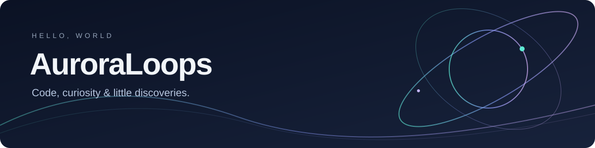

**写一点代码，做一点有趣的东西，也记录沿途的风景。**

Small tools. Creative experiments. Moments worth keeping.

[About](#about-me) · [Interests](#what-i-explore) · [Now](#currently)

---

### About me

Hi, I'm **AuroraLoops** 👋

这里用来收集我的代码实验、学习笔记和个人作品。
我喜欢从生活里的小需求出发，把想法慢慢变成能使用的东西。

### What I explore

| 方向 | 感兴趣的事 |
| :--- | :--- |
| 🛠️ Tools & automation | Python、小工具、简化重复操作 |
| ✨ Creative coding | AI 应用、交互体验、个人网站 |
| 📷 Beyond the screen | 摄影、旅行、用影像和地图记录生活 |

### Currently

- 🌱 边做边学，把零散的尝试整理成可以复用的项目。
- 🧩 关注工具的实际体验，也记录解决问题的过程。
- 📝 逐步整理适合公开的作品与笔记。

---

Stay curious. Make something useful. Keep exploring.

